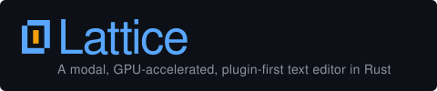

# Dhruva Sagar

**Fractional CTO · Software Architect · Engineering Leader**

[](https://www.linkedin.com/in/dhruvasagar)
[](https://twitter.com/dhruvasagar)
[](https://dhruvasagar.dev)
[](mailto:dhruva.sagar@protonmail.com)

---

I partner with founders and product teams as a **Fractional CTO** — bringing ~20 years of engineering depth across product strategy, system architecture, security, and delivery. I've led teams, shaped platforms, and shipped software across industries. My work sits at the intersection of technical rigor and business outcomes.

I care deeply about **software craftsmanship**: sound architecture, clean abstractions, developer experience, and building systems that age well. I'm equally at home auditing a codebase, defining an engineering roadmap, or pairing with a team to untangle a gnarly problem.

---

## What I Do

- **Fractional CTO / Technical Advisory** — Embedded leadership for early-stage and scaling companies: roadmap ownership, architecture decisions, team structure, hiring bars, and vendor evaluation.
- **Engineering Due Diligence** — Code and architecture audits for investors and acquirers; compliance and security posture reviews.
- **Platform & Product Architecture** — Full-stack systems design, API strategy, data modeling, and release pipeline design.
- **Team Enablement** — Engineering culture, process design, documentation practices, and mentorship.

---

## Stack & Craft

Over two decades I've worked across many layers of the stack. Here's where I spend most of my time today:

- **Languages I reach for:** Rust · Go · TypeScript · Python · Ruby · Haskell · Elixir
- **Infrastructure:** Linux · PostgreSQL · Redis · Docker · AWS
- **Tooling:** Emacs (daily driver) · (Neo)vim · Git · TUI tools · Terminal-first workflows

I'm currently deepening my work in **Rust** and **Haskell** — languages where the type system does serious work.

---

## Featured: Lattice

<picture>
  <source media="(prefers-color-scheme: dark)" srcset="./media/banner-dark.svg">
  <source media="(prefers-color-scheme: light)" srcset="./media/banner-light.svg">
  
</picture>

> **[dhruvasagar/lattice](https://github.com/dhruvasagar/lattice)** — A modal, GPU-accelerated, plugin-first text editor written in Rust.

My most ambitious open-source project, and now a released one: **0.9 is out** as a public alpha. Lattice is not a config layer or a fork — it's a ground-up text editor built on the conviction that Vim and Emacs each got one thing profoundly right, and that a modern Rust foundation can have both without their compromises.

```sh
curl -fsSL https://raw.githubusercontent.com/dhruvasagar/lattice/main/install.sh | sh
```

[Install guide](https://dhruvasagar.github.io/lattice/install/) · [Releases](https://github.com/dhruvasagar/lattice/releases) · [Plugins](https://dhruvasagar.github.io/lattice/plugins/) · [Discord](https://discord.gg/qbTW5gP4mz)

**What makes it different:**

- **Vim's modal grammar is the public command API** — not a keymap over a non-modal core. Operators, motions, text objects, counts, registers, macros, ex ranges. Adding a motion *is* extending the grammar.
- **Emacs's extensibility model via WebAssembly** — plugins are sandboxed WASM components, capability-gated and crash-isolated. The API is WIT, so it is not tied to one language, and your config is Rust compiled to WASM. Org-mode ships as a [plugin](https://github.com/dhruvasagar/lattice-org-plugin) with not a line in the editor's tree.
- **Everything is a buffer, enforced** — file tree, search results, diagnostics, terminal, build output — all placed via splits. No fixed sidebars or bottom panels. One code path for all buffer kinds.
- **Nothing blocks the UI, by construction** — the UI thread does no I/O, no parsing, no shaping. The bar is a keystroke landing within one display frame under any background load, and CI ratchets the measured latency.
- **Two first-class renderers** — a terminal UI for SSH and a GPU-rendered window, over the same core. Neither is the fallback.

**What works today:** the Vim grammar, LSP (completion, diagnostics, hover, rename, references, inlay hints, code actions), tree-sitter for 20 languages, a real magit port (stage by hunk, commit, rebase, blame, log), a compilation buffer with jump-to-error, and coding agents as buffers (Claude Code over MCP, ACP conversations with diff review).

**Where it stands:** 3,700+ commits across 41 crates, backed by a [design spec](https://github.com/dhruvasagar/lattice/blob/main/docs/dev/architecture/design.md) and CI-tracked performance benchmarks. It is an alpha: the editing is solid, the distribution is new — [known limitations](https://dhruvasagar.github.io/lattice/docs/start/known-limitations/) are listed honestly.

---

## Other Open Source

| Project | Description |
|---|---|
| [vim-table-mode](https://github.com/dhruvasagar/vim-table-mode) | Automatic table formatting for Vim — widely used, actively maintained |
| [vim-dotoo](https://github.com/dhruvasagar/vim-dotoo) | Org-mode inspired task management inside Vim |
| [vim-prosession](https://github.com/dhruvasagar/vim-prosession) | Ergonomic session management for Vim |
| [vim-testify](https://github.com/dhruvasagar/vim-testify) | Unit testing framework for VimScript |
| [dumbhttp](https://github.com/dhruvasagar/dumbhttp) | Lightweight HTTP mock server in Rust |
| [cursed-timer](https://github.com/dhruvasagar/cursed-timer) | Rubik's Cube timer — a TUI app in Rust |
| [url-mapper-rs](https://github.com/dhruvasagar/url-mapper-rs) | Keyword-based URL mapper in Rust |

---

## A Few Things About Me

- I automate relentlessly — if I do something twice, I script it
- Linux is home; the terminal is where I live
- I make technical content on YouTube: [youtube.com/@softwarecraftsmanship](https://www.youtube.com/channel/UCWC5C7O-jpJhHW7sSxu-27A) — more in the pipeline
- Competitive programming enthusiast
- Pronouns: He/Him

---

## GitHub at a Glance

<p align="center">
  
  &nbsp;&nbsp;
  
</p>

<p align="center">
  
</p>

---

*Open to select fractional and advisory engagements. Reach me at [dhruva.sagar@protonmail.com](mailto:dhruva.sagar@protonmail.com)*
